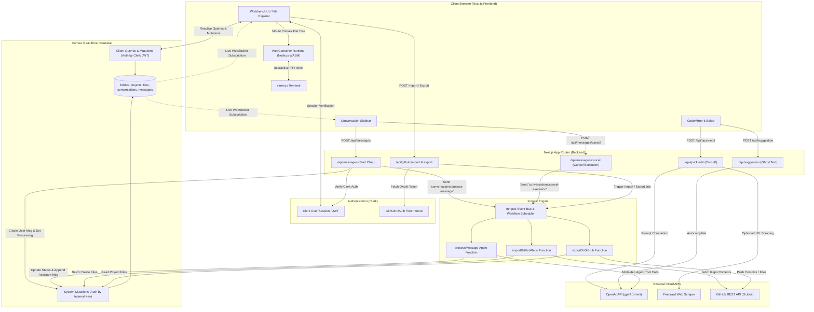
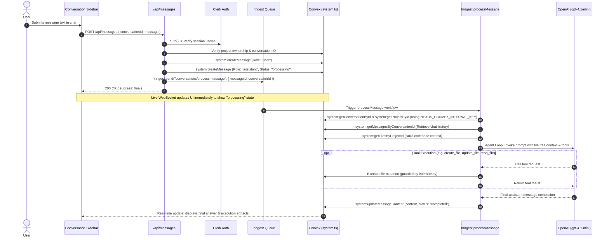

# Nexus Architecture & System Design

This document details the architectural design, component responsibilities, data flow, security boundaries, and background agent execution model in Nexus.

---

## 1. System Overview

Nexus is structured into distinct, decoupled execution layers:

1. **Frontend Presentation & Editing (Next.js 16 / React 19 / CodeMirror 6):**
   - Single-page application rendering the IDE workbench, code editor, file explorer, preview panel, and conversation sidebar.
   - Subscribes reactively to Convex queries for immediate state synchronization.

2. **Database & Real-Time Sync (Convex):**
   - Cloud-native real-time database maintaining projects, hierarchical files, conversation messages, and execution traces.
   - Enforces user identity using Clerk JWT tokens on client-initiated queries/mutations.
   - Exposes internal system mutations for privileged server-to-server operations guarded by `NEXUS_CONVEX_INTERNAL_KEY`.

3. **Background Job Orchestration (Inngest):**
   - Durable, event-driven workflow engine that executes long-running asynchronous tasks (AI assistant agent iterations, GitHub repository imports, and batched file exports).
   - Handles multi-step orchestration, automatic retries, exponential backoffs, and execution cancellation.

4. **In-Browser Execution Runtime (WebContainer API & xterm.js):**
   - Sandboxed Node.js WebAssembly container running entirely client-side in the browser.
   - Mounts virtual file trees generated from Convex file documents and runs local dev servers, build tools, and interactive terminals.

5. **AI Services (OpenAI & Vercel AI SDK):**
   - Powers ghost-text code autocompletions (`/api/suggestion`), natural language quick edits (`/api/quick-edit`), and multi-step tool-calling assistant agents (`process-message`).

6. **Authentication & Identity (Clerk):**
   - Manages user sessions, JWT issuance for Convex, and user OAuth access tokens for GitHub repository operations.

---

## 2. Architecture Diagram

---

## 3. Component Responsibilities

### Next.js App Router (Client & Server)
- **Frontend Components:** Organizes UI into feature modules (`src/features/`): `auth`, `conversations`, `editor`, `preview`, `projects`.
- **API Routes (`src/app/api/`):** Thin server-side endpoints validating incoming request schemas using Zod, verifying Clerk user sessions via `auth()`, and dispatching durable background jobs to Inngest.

### Convex Real-Time Layer (`convex/`)
- **Schema (`convex/schema.ts`):** Defines strict relational document tables: `projects`, `files`, `conversations`, `messages`.
- **Client Endpoints:** Queries and mutations checking `ctx.auth.getUserIdentity()` to ensure users only access their own projects.
- **System Endpoints (`convex/system.ts`):** Privileged queries/mutations used by Inngest workers and internal APIs, authenticated via `NEXUS_CONVEX_INTERNAL_KEY`.

### Inngest Background Engine (`src/inngest/` & Feature Functions)
- **Durable Step Execution:** Breaks complex workflows into distinct retryable steps (`step.run`).
- **AI Agent Execution:** Hosts the `@inngest/agent-kit` network driving conversation tools and reasoning steps.
- **Rate-Limit & Retry Handling:** Automatically retries transient network or API failures with exponential backoff.

### WebContainer Runtime (`src/features/preview/hooks/use-webcontainer.ts`)
- **Singleton Lifecycle:** Boots a browser-contained Node.js environment (`WebContainer.boot({ coep: "credentialless" })`).
- **Virtual File Tree:** Converts flat Convex files into nested directory structures via `buildFileTree`.
- **Terminal Emulator:** Attaches xterm.js to WebContainer shell processes (`jsh`) for live command execution.

---

## 4. End-to-End AI Message Lifecycle

The processing of an AI assistant message proceeds through the following sequential lifecycle:

---

## 5. Security Architecture & Boundary Isolation

### 1. Client-to-Convex Authentication
- Client interactions with Convex pass Clerk session JWTs automatically through `<ConvexProviderWithClerk>`.
- Public Convex queries and mutations verify identity using `await ctx.auth.getUserIdentity()`. Unauthenticated queries or queries targeting projects owned by another `userId` throw authorization errors.

### 2. Internal Service-to-Convex Authentication (`NEXUS_CONVEX_INTERNAL_KEY`)
- System-level operations (such as AI background workers updating assistant responses or creating files) bypass the end-user request lifecycle.
- To prevent unauthorized manipulation of arbitrary files or projects, all mutations in `convex/system.ts` validate `args.internalKey === process.env.NEXUS_CONVEX_INTERNAL_KEY`.
- If the internal key is absent or mismatched, Convex aborts the mutation immediately.

### 3. Server-Side Secret Isolation
- `CLERK_SECRET_KEY`, `OPENAI_API_KEY`, `FIRECRAWL_API_KEY`, and `NEXUS_CONVEX_INTERNAL_KEY` are strictly server-side variables.
- None of these are prefixed with `NEXT_PUBLIC_`, ensuring they are never bundled into client JavaScript.

### 4. WebContainer Sandbox & Cross-Origin Isolation
- WebContainer requires `SharedArrayBuffer` support in modern browsers.
- In `next.config.ts`, Nexus configures:
  - `Cross-Origin-Embedder-Policy: credentialless`
  - `Cross-Origin-Opener-Policy: same-origin`
- This isolates the browser execution environment and prevents cross-origin data leakage.

---

## 6. Development vs. Production Deployment Architecture

| Dimension | Local Development | Production |
| :--- | :--- | :--- |
| **Next.js Hosting** | `localhost:3000` via `next dev` | Vercel / Node server container |
| **Database** | Convex Dev Deployment (`npx convex dev`) | Convex Production Deployment |
| **Background Jobs** | Local Inngest Dev Server (`npx inngest-cli dev`) | Inngest Cloud / Webhooks |
| **Auth Domain** | `clerk.accounts.dev` | Custom production domain |
| **Internal Key** | Set in `.env.local` + Convex Dev Env | Set in Vercel Env + Convex Prod Env |
