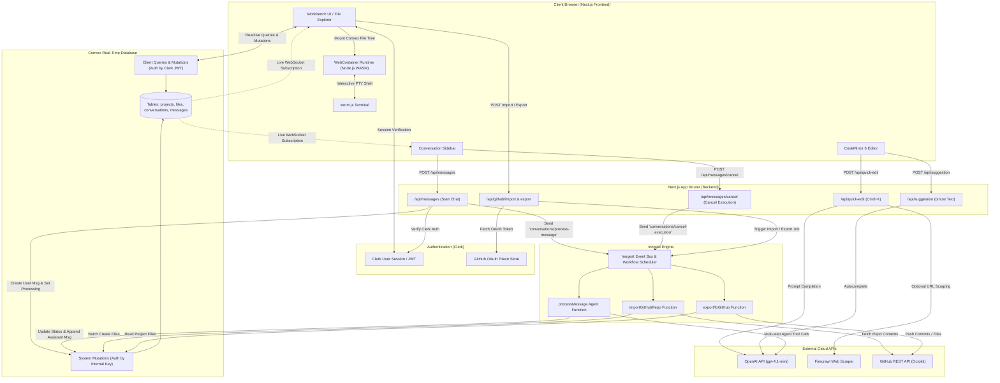
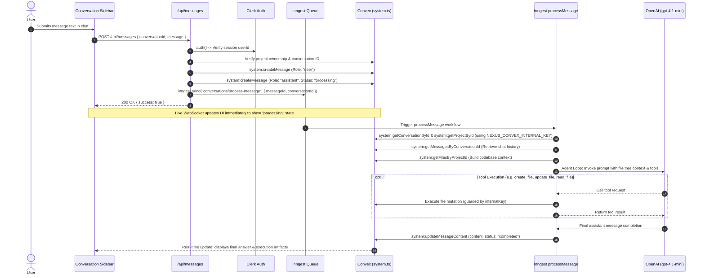
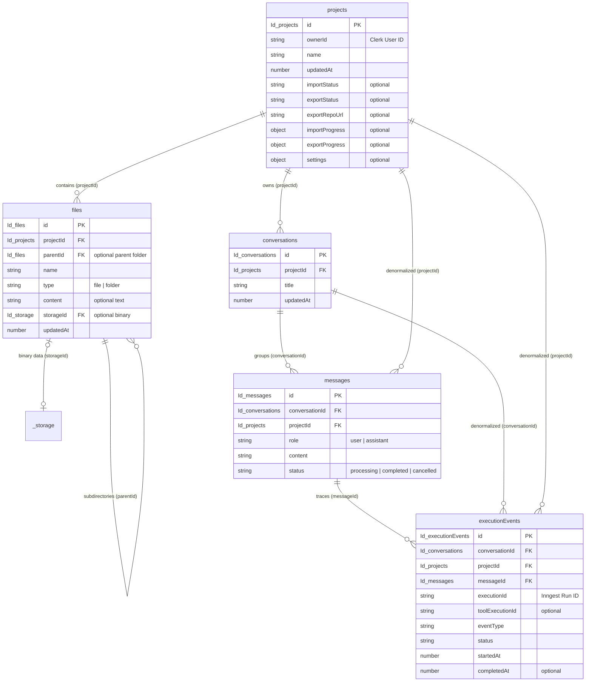

# Nexus Architecture & System Design

This document details the architectural design, component responsibilities, data flow, security boundaries, and background agent execution model in Nexus.

---

## 1. System Overview

Nexus is structured into distinct, decoupled execution layers:

1. **Frontend Presentation & Editing (Next.js 16 / React 19 / CodeMirror 6):**
   - Single-page application rendering the IDE workbench, code editor, file explorer, preview panel, and conversation sidebar.
   - Subscribes reactively to Convex queries for immediate state synchronization.

2. **Database & Real-Time Sync (Convex):**
   - Cloud-native real-time database maintaining projects, hierarchical files, conversation messages, and execution traces.
   - Enforces user identity using Clerk JWT tokens on client-initiated queries/mutations.
   - Exposes internal system mutations for privileged server-to-server operations guarded by `NEXUS_CONVEX_INTERNAL_KEY`.

3. **Background Job Orchestration (Inngest):**
   - Durable, event-driven workflow engine that executes long-running asynchronous tasks (AI assistant agent iterations, GitHub repository imports, and batched file exports).
   - Handles multi-step orchestration, automatic retries, exponential backoffs, and execution cancellation.

4. **In-Browser Execution Runtime (WebContainer API & xterm.js):**
   - Sandboxed Node.js WebAssembly container running entirely client-side in the browser.
   - Mounts virtual file trees generated from Convex file documents and runs local dev servers, build tools, and interactive terminals.

5. **AI Services (OpenAI & Vercel AI SDK):**
   - Powers ghost-text code autocompletions (`/api/suggestion`), natural language quick edits (`/api/quick-edit`), and multi-step tool-calling assistant agents (`process-message`).

6. **Authentication & Identity (Clerk):**
   - Manages user sessions, JWT issuance for Convex, and user OAuth access tokens for GitHub repository operations.

---

## 2. Architecture Diagram



---

## 3. Component Responsibilities

### Next.js App Router (Client & Server)
- **Frontend Components:** Organizes UI into feature modules (`src/features/`): `auth`, `conversations`, `editor`, `preview`, `projects`.
- **API Routes (`src/app/api/`):** Thin server-side endpoints validating incoming request schemas using Zod, verifying Clerk user sessions via `auth()`, and dispatching durable background jobs to Inngest.

### Convex Real-Time Layer (`convex/`)
- **Schema (`convex/schema.ts`):** Defines strict relational document tables: `projects`, `files`, `conversations`, `messages`.
- **Client Endpoints:** Queries and mutations checking `ctx.auth.getUserIdentity()` to ensure users only access their own projects.
- **System Endpoints (`convex/system.ts`):** Privileged queries/mutations used by Inngest workers and internal APIs, authenticated via `NEXUS_CONVEX_INTERNAL_KEY`.

### Inngest Background Engine (`src/inngest/` & Feature Functions)
- **Durable Step Execution:** Breaks complex workflows into distinct retryable steps (`step.run`).
- **AI Agent Execution:** Hosts the `@inngest/agent-kit` network driving conversation tools and reasoning steps.
- **Rate-Limit & Retry Handling:** Automatically retries transient network or API failures with exponential backoff.

### WebContainer Runtime (`src/features/preview/hooks/use-webcontainer.ts`)
- **Singleton Lifecycle:** Boots a browser-contained Node.js environment (`WebContainer.boot({ coep: "credentialless" })`).
- **Virtual File Tree:** Converts flat Convex files into nested directory structures via `buildFileTree`.
- **Terminal Emulator:** Attaches xterm.js to WebContainer shell processes (`jsh`) for live command execution.

---

## 4. End-to-End AI Message Lifecycle

The processing of an AI assistant message proceeds through the following sequential lifecycle:



---

## 5. Security Architecture & Boundary Isolation

### 1. Client-to-Convex Authentication
- Client interactions with Convex pass Clerk session JWTs automatically through `<ConvexProviderWithClerk>`.
- Public Convex queries and mutations verify identity using `await ctx.auth.getUserIdentity()`. Unauthenticated queries or queries targeting projects owned by another `userId` throw authorization errors.

### 2. Internal Service-to-Convex Authentication (`NEXUS_CONVEX_INTERNAL_KEY`)
- System-level operations (such as AI background workers updating assistant responses or creating files) bypass the end-user request lifecycle.
- To prevent unauthorized manipulation of arbitrary files or projects, all mutations in `convex/system.ts` validate `args.internalKey === process.env.NEXUS_CONVEX_INTERNAL_KEY`.
- If the internal key is absent or mismatched, Convex aborts the mutation immediately.

### 3. Server-Side Secret Isolation
- `CLERK_SECRET_KEY`, `OPENAI_API_KEY`, `FIRECRAWL_API_KEY`, and `NEXUS_CONVEX_INTERNAL_KEY` are strictly server-side variables.
- None of these are prefixed with `NEXT_PUBLIC_`, ensuring they are never bundled into client JavaScript.

### 4. WebContainer Sandbox & Cross-Origin Isolation
- WebContainer requires `SharedArrayBuffer` and WebAssembly threads support in modern browsers.
- In `next.config.ts`, Nexus configures:
  - `Cross-Origin-Embedder-Policy: credentialless`
  - `Cross-Origin-Opener-Policy: same-origin`
- This isolates the browser execution environment, satisfies browser security gates for `SharedArrayBuffer`, and prevents cross-origin data leakage while permitting necessary subresources (fonts, images, external previews) without strict CORP headers.
- For complete browser support matrices, reverse-proxy header preservation guidelines, verification checks, and debugging procedures, see [Section 9: WebContainer Browser Compatibility and Deployment Guide](#9-webcontainer-browser-compatibility-and-deployment-guide).

---

## 6. Development vs. Production Deployment Architecture

| Dimension | Local Development | Production |
| :--- | :--- | :--- |
| **Next.js Hosting** | `localhost:3000` via `next dev` | Vercel / Node server container |
| **Database** | Convex Dev Deployment (`npx convex dev`) | Convex Production Deployment |
| **Background Jobs** | Local Inngest Dev Server (`npx inngest-cli dev`) | Inngest Cloud / Webhooks |
| **Auth Domain** | `clerk.accounts.dev` | Custom production domain |
| **Internal Key** | Set in `.env.local` + Convex Dev Env | Set in Vercel Env + Convex Prod Env |

---

## 7. API Route Reference

Nexus exposes several Next.js App Router API endpoints under `src/app/api/`. These handle AI code suggestions, conversational assistant tasks, quick code transformations, project lifecycle events, and GitHub integrations.

### A. Overview
- **Location:** All HTTP API route handlers are organized within subdirectories of `src/app/api/` as `route.ts` files exporting standard Next.js App Router methods (`POST`, `GET`, `PUT`).
- **Authentication Model:**
  - **User Endpoints:** Authenticated via Clerk (`await auth()`). Unauthenticated requests receive HTTP `401 Unauthorized` (or HTTP `403 Forbidden` on `/api/suggestion`).
  - **Ownership Verification:** Routes that operate on existing resources (`projectId` or `conversationId`) verify that the entity exists in Convex and that its `ownerId` matches the authenticated `userId`. Failing ownership returns HTTP `403 Forbidden` or `404 Not Found`.
  - **Server-to-Server / Background Endpoints:** Use internal keys (`NEXUS_CONVEX_INTERNAL_KEY`) or Inngest signing keys (`INNGEST_SIGNING_KEY`).
- **Internal Mutations:** Privileged mutations in Convex are executed via internal keys (`api.system.*`) through `@/lib/convex-client`.

---

### B. Route Inventory

| Endpoint | Method(s) | Primary Purpose | Authentication / Security |
|---|---|---|---|
| `/api/messages` | `POST` | Send user message to conversation; cancels active messages and triggers Inngest assistant | Clerk User + Project Ownership |
| `/api/messages/cancel` | `POST` | Cancel active assistant messages and tool execution runs for a project | Clerk User + Project Ownership |
| `/api/quick-edit` | `POST` | Perform in-place AI code edits with optional web scraping via Firecrawl | Clerk User |
| `/api/suggestion` | `POST` | Generate inline ghost-text code completions at cursor position | Clerk User |
| `/api/projects/create-with-prompt` | `POST` | Create a new project and initial conversation seeded from user prompt | Clerk User |
| `/api/github/import` | `POST` | Import a remote GitHub repository into a new Nexus project | Clerk User + Clerk GitHub OAuth |
| `/api/github/export` | `POST` | Export project repository files to GitHub as a new public/private repo | Clerk User + Project Ownership + GitHub OAuth |
| `/api/github/export/cancel` | `POST` | Cancel an in-flight GitHub export workflow and mark status cancelled | Clerk User |
| `/api/github/export/reset` | `POST` | Reset export state and repository URL for a project | Clerk User |
| `/api/inngest` | `GET`, `POST`, `PUT` | Inngest webhook communication and workflow handler execution | Inngest Signature / SDK |

---

### C. Detailed Endpoint Contracts

#### 1. `POST /api/messages`
- **Source:** [`src/app/api/messages/route.ts`](../src/app/api/messages/route.ts)
- **Purpose:** Appends a user prompt to an existing conversation, marks any active assistant messages in the project as cancelled, creates a placeholder assistant message with status `"processing"`, and dispatches an asynchronous Inngest agent execution event.
- **Authentication:** Required (Clerk session).
- **Authorization & Ownership:**
  1. Queries Convex `api.system.getConversationById` to resolve target project ID.
  2. Queries Convex `api.system.getProjectById` and verifies `project.ownerId === userId`.
- **Request Body (JSON):**
  | Field | Type | Required | Description |
  |---|---|---|---|
  | `conversationId` | string | Yes | ID of conversation to receive message |
  | `message` | string | Yes | Non-empty trimmed text prompt |
- **Success Response:** `200 OK`
  ```json
  {
    "success": true,
    "eventId": "01J...",
    "messageId": "msg_..."
  }
  ```
- **Error Responses:**
  - `400 Bad Request`: Invalid request body or empty message.
  - `401 Unauthorized`: Missing or invalid Clerk authentication session.
  - `403 Forbidden`: Authenticated user does not own the target project.
  - `404 Not Found`: Conversation or Project not found.
  - `500 Internal Server Error`: `NEXUS_CONVEX_INTERNAL_KEY` not configured.
- **Background Side Effects:**
  - Dispatches `message/cancel` Inngest events and mutates processing messages to `"cancelled"`.
  - Dispatches `message/sent` event to Inngest to trigger `processMessage` AI loop.

---

#### 2. `POST /api/messages/cancel`
- **Source:** [`src/app/api/messages/cancel/route.ts`](../src/app/api/messages/cancel/route.ts)
- **Purpose:** Cancels any currently processing assistant messages and active background Inngest tool runs for a given project.
- **Authentication:** Required (Clerk session).
- **Authorization & Ownership:**
  - Verifies project exists and `project.ownerId === userId`.
- **Request Body (JSON):**
  | Field | Type | Required | Description |
  |---|---|---|---|
  | `projectId` | string | Yes | Target project ID |
- **Success Response:** `200 OK`
  - When messages were running and cancelled:
    ```json
    { "success": true, "cancelled": true, "messageIds": ["msg_123"] }
    ```
  - When no messages were processing:
    ```json
    { "success": true, "cancelled": false }
    ```
- **Error Responses:**
  - `400 Bad Request`: Missing or invalid `projectId`.
  - `401 Unauthorized`: Unauthenticated request.
  - `403 Forbidden`: User does not own the project.
  - `404 Not Found`: Project not found.
  - `500 Internal Server Error`: Internal key not configured.
- **Background Side Effects:**
  - Sends `message/cancel` to Inngest for each in-flight message.
  - Updates Convex message statuses to `"cancelled"` and records execution termination summary.

---

#### 3. `POST /api/quick-edit`
- **Source:** [`src/app/api/quick-edit/route.ts`](../src/app/api/quick-edit/route.ts)
- **Purpose:** Natural language in-place code modification assistant for selected code regions (Cmd+K / Ctrl+K), with optional external URL scraping via Firecrawl.
- **Authentication:** Required (Clerk session).
- **Authorization & Ownership:** Validates authenticated caller (`userId` check). No project boundary check required as code context is supplied directly in request payload.
- **Request Body (JSON):**
  | Field | Type | Required | Description |
  |---|---|---|---|
  | `selectedCode` | string | Yes | Selected source code block to modify |
  | `instruction` | string | Yes | Natural-language edit instruction |
  | `fullCode` | string | No | Surrounding file content providing context |
- **Success Response:** `200 OK`
  ```json
  { "editedCode": "const x = 42;" }
  ```
- **Error Responses:**
  - `400 Bad Request`: `selectedCode` or `instruction` missing.
  - `401 Unauthorized`: Caller is not logged in.
  - `500 Internal Server Error`: AI generation failure or external provider error.
- **Background Side Effects:**
  - If URLs are detected in instruction, calls Firecrawl scrape API to retrieve Markdown documentation.
  - Calls OpenAI API (`gpt-4.1-mini`) with structured object output schema.

---

#### 4. `POST /api/suggestion`
- **Source:** [`src/app/api/suggestion/route.ts`](../src/app/api/suggestion/route.ts)
- **Purpose:** Generates lightweight real-time inline ghost-text code completions as the user types in the editor.
- **Authentication:** Required (Clerk session). Returns `403 Forbidden` if unauthenticated.
- **Authorization & Ownership:** Caller must be authenticated.
- **Request Body (JSON):**
  | Field | Type | Required | Description |
  |---|---|---|---|
  | `code` | string | Yes | Full file content |
  | `fileName` | string | Yes | Target file name |
  | `currentLine` | string | Yes | Text on active line |
  | `lineNumber` | number | Yes | Active cursor line number |
  | `textBeforeCursor` | string | Yes | Characters preceding cursor on line |
  | `textAfterCursor` | string | Yes | Characters following cursor on line |
  | `previousLines` | string | No | Preceding lines of code context |
  | `nextLines` | string | No | Succeeding lines of code context |
- **Success Response:** `200 OK`
  ```json
  { "suggestion": "return value;" }
  ```
- **Error Responses:**
  - `400 Bad Request`: Missing `code` payload.
  - `403 Forbidden`: Caller is not logged in.
  - `500 Internal Server Error`: Completion generation failure.
- **Background Side Effects:** Invokes OpenAI `gpt-4.1-mini` via Vercel AI SDK.

---

#### 5. `POST /api/projects/create-with-prompt`
- **Source:** [`src/app/api/projects/create-with-prompt/route.ts`](../src/app/api/projects/create-with-prompt/route.ts)
- **Purpose:** Automatically provisions a new project with a unique name, creates its default conversation, inserts the initial user message, and launches the AI assistant Inngest workflow.
- **Authentication:** Required (Clerk session).
- **Authorization & Ownership:** Authenticated user is designated as the `ownerId` of the newly created project in Convex.
- **Request Body (JSON):**
  | Field | Type | Required | Description |
  |---|---|---|---|
  | `prompt` | string | Yes | Initial prompt to bootstrap project |
- **Success Response:** `200 OK`
  ```json
  { "projectId": "proj_123" }
  ```
- **Error Responses:**
  - `400 Bad Request`: Invalid request body or empty prompt.
  - `401 Unauthorized`: Unauthenticated user session.
  - `500 Internal Server Error`: Missing server internal key.
- **Background Side Effects:**
  - Generates 3-word random project identifier (e.g. `fast-blue-tiger`).
  - Calls Convex `api.system.createProjectWithConversation` and `api.system.createMessage`.
  - Dispatches `message/sent` Inngest event to start background agent processing.

---

#### 6. `POST /api/github/import`
- **Source:** [`src/app/api/github/import/route.ts`](../src/app/api/github/import/route.ts)
- **Purpose:** Imports an external GitHub repository into Nexus by creating a local project and dispatching an asynchronous repository cloning & file population job.
- **Authentication:** Required (Clerk user session + Clerk GitHub OAuth token).
- **Authorization & Ownership:** Creates a new project owned by the authenticated `userId`.
- **Request Body (JSON):**
  | Field | Type | Required | Description |
  |---|---|---|---|
  | `url` | string | Yes | Valid GitHub repository URL |
- **Success Response:** `200 OK`
  ```json
  {
    "success": true,
    "projectId": "proj_123",
    "eventId": "01J..."
  }
  ```
- **Error Responses:**
  - `400 Bad Request`: Invalid GitHub URL or GitHub account not linked in Clerk.
  - `401 Unauthorized`: Unauthenticated session.
  - `500 Internal Server Error`: Server configuration error (`NEXUS_CONVEX_INTERNAL_KEY` missing).
- **Background Side Effects:**
  - Retrieves GitHub OAuth token from Clerk OAuth store.
  - Creates project in Convex via `api.system.createProject`.
  - Dispatches `github/import.repo` Inngest job to fetch repository tree and write files.

---

#### 7. `POST /api/github/export`
- **Source:** [`src/app/api/github/export/route.ts`](../src/app/api/github/export/route.ts)
- **Purpose:** Initiates asynchronous batch export of a project's files into a GitHub repository.
- **Authentication:** Required (Clerk user session + Clerk GitHub OAuth token).
- **Authorization & Ownership:** Verifies that the project exists and `project.ownerId === userId`.
- **Request Body (JSON):**
  | Field | Type | Required | Default | Description |
  |---|---|---|---|---|
  | `projectId` | string | Yes | - | ID of project to export |
  | `repoName` | string | Yes | - | Name of target repository (1-100 chars) |
  | `visibility` | string | No | `"private"` | `"public"` or `"private"` |
  | `description` | string | No | - | Optional repository description (max 350 chars) |
- **Success Response:** `200 OK`
  ```json
  {
    "success": true,
    "projectId": "proj_123",
    "eventId": "01J..."
  }
  ```
- **Error Responses:**
  - `400 Bad Request`: Validation failure or GitHub not connected.
  - `401 Unauthorized`: Unauthenticated caller.
  - `403 Forbidden`: User does not own the project.
  - `404 Not Found`: Project does not exist.
  - `500 Internal Server Error`: Server configuration error.
- **Background Side Effects:**
  - Dispatches `github/export.repo` Inngest workflow to batch-upload Git blobs, trees, and commits.

---

#### 8. `POST /api/github/export/cancel`
- **Source:** [`src/app/api/github/export/cancel/route.ts`](../src/app/api/github/export/cancel/route.ts)
- **Purpose:** Cancels an ongoing GitHub export pipeline for a given project.
- **Authentication:** Required (Clerk user session).
- **Authorization & Ownership:** Authenticated session required.
- **Request Body (JSON):**
  | Field | Type | Required | Description |
  |---|---|---|---|
  | `projectId` | string | Yes | Project ID of export to cancel |
- **Success Response:** `200 OK`
  ```json
  { "success": true, "projectId": "proj_123", "eventId": "01J..." }
  ```
- **Error Responses:**
  - `400 Bad Request`: Invalid request payload.
  - `401 Unauthorized`: Unauthenticated caller.
  - `500 Internal Server Error`: Server configuration error.
- **Background Side Effects:**
  - Dispatches `github/export.cancel` to Inngest.
  - Mutates Convex export status to `"cancelled"`.

---

#### 9. `POST /api/github/export/reset`
- **Source:** [`src/app/api/github/export/reset/route.ts`](../src/app/api/github/export/reset/route.ts)
- **Purpose:** Clears export metadata (`exportStatus` and `repoUrl`) on a project, allowing a fresh export attempt.
- **Authentication:** Required (Clerk user session).
- **Authorization & Ownership:** Authenticated session required.
- **Request Body (JSON):**
  | Field | Type | Required | Description |
  |---|---|---|---|
  | `projectId` | string | Yes | Project ID |
- **Success Response:** `200 OK`
  ```json
  { "success": true, "projectId": "proj_123" }
  ```
- **Error Responses:**
  - `400 Bad Request`: Missing project ID.
  - `401 Unauthorized`: Unauthenticated caller.
  - `500 Internal Server Error`: Missing server configuration key.
- **Background Side Effects:** Calls Convex `api.system.updateExportStatus` to reset state to `undefined`.

---

#### 10. `GET`, `POST`, `PUT /api/inngest`
- **Source:** [`src/app/api/inngest/route.ts`](../src/app/api/inngest/route.ts)
- **Purpose:** Serves as the webhook transport endpoint for the Inngest execution engine. Coordinates execution of background workflows:
  - `processMessage`: AI assistant agent multi-step loop.
  - `importGithubRepo`: GitHub repository cloning and file writing.
  - `exportToGithub`: Batched GitHub repository commits and pushes.
- **Authentication & Security:** Managed by Inngest SDK using HMAC header signatures in production or local CLI connection in development.
- **Request & Response:** Handled automatically by `serve()` from `inngest/next`.

---

### D. Security & Ownership Summary

```
+-------------------------------------------------------------------------+
| Authenticated User (Clerk Session)                                      |
+-------------------------------------------------------------------------+
        |
        +---> /api/suggestion                    (Requires Auth)
        +---> /api/quick-edit                     (Requires Auth)
        +---> /api/projects/create-with-prompt   (Requires Auth)
        +---> /api/github/import                 (Requires Auth + GitHub OAuth)
        +---> /api/github/export/cancel          (Requires Auth)
        +---> /api/github/export/reset           (Requires Auth)
        |
        v
+-------------------------------------------------------------------------+
| Ownership Guarded Endpoints (Project ownerId === userId)                |
+-------------------------------------------------------------------------+
        |
        +---> /api/messages                      (Verifies Project Owner)
        +---> /api/messages/cancel               (Verifies Project Owner)
        +---> /api/github/export                 (Verifies Project Owner + OAuth)
        |
        v
+-------------------------------------------------------------------------+
| Internal Execution Boundaries (Guarded by NEXUS_CONVEX_INTERNAL_KEY)    |
+-------------------------------------------------------------------------+
        |
        +---> Convex system.* mutations
        +---> Inngest background workers (/api/inngest)
```

---

### E. Error Handling Conventions

Next.js API routes return consistent JSON error envelopes:
```json
{
  "error": "Descriptive error message"
}
```

HTTP status codes strictly reflect the underlying condition:
- `400 Bad Request`: Malformed JSON, missing mandatory properties, or Zod validation rejections.
- `401 Unauthorized`: Missing Clerk session (unauthenticated user).
- `403 Forbidden`: Authenticated user lacks permission to access or modify the specified project.
- `404 Not Found`: Target project or conversation does not exist.
- `500 Internal Server Error`: Server configuration errors (e.g. missing `NEXUS_CONVEX_INTERNAL_KEY`) or unhandled exceptions.

---

## 8. Convex Data Model and Mutation Lifecycle

Nexus uses [Convex](https://www.convex.dev) as its real-time reactive cloud database and document storage engine. Convex maintains workspace projects, virtual file systems, chat conversations, assistant messages, execution traces, import/export progress states, and environment configurations.

This section details the complete Convex data model, entity relationships, access authorization boundaries, index patterns, cascade deletion lifecycles, and contributor best practices.

### A. Data Model Overview

In Nexus, data persistence and synchronization follow strict boundary principles:
1. **Project as the Primary Ownership Boundary:**
   The `projects` table acts as the primary root entity for user authorization. Every user-created resource—files, conversations, messages, and execution traces—directly or transitively belongs to a project. An entity's access rights are determined by verifying whether the authenticated user's Clerk ID matches the project's `ownerId`.
2. **Document IDs as Typed Foreign References:**
   Convex documents utilize auto-generated, strongly typed IDs (`Id<"tableName">`). Relational integrity across tables (e.g., `files.projectId -> projects._id`, `files.parentId -> files._id`, `messages.conversationId -> conversations._id`) is managed and enforced through application logic in Convex mutations and queries.
3. **Dual Execution Paths (Client vs. System):**
   - **Public client mutations/queries** (`convex/projects.ts`, `convex/conversations.ts`, `convex/files.ts`) verify end-user identity via Clerk JWTs (`await ctx.auth.getUserIdentity()`).
   - **Internal system mutations/queries** (`convex/system.ts`) facilitate background agent workflows (Inngest workers) and Next.js server actions, secured by `args.internalKey === process.env.NEXUS_CONVEX_INTERNAL_KEY`.
4. **Source of Truth:**
   The definitive schema definitions reside in [`convex/schema.ts`](../convex/schema.ts), while the concrete authorization and lifecycle semantics are enforced across [`convex/projects.ts`](../convex/projects.ts), [`convex/conversations.ts`](../convex/conversations.ts), [`convex/files.ts`](../convex/files.ts), and [`convex/system.ts`](../convex/system.ts).

---

### B. Table Reference

The Convex database schema defines 5 document tables: `projects`, `files`, `conversations`, `messages`, and `executionEvents`.

#### 1. `projects`
- **Source:** [`convex/schema.ts`](../convex/schema.ts#L5-L71)
- **Purpose:** Root entity representing a user's development workspace, containing project metadata, Git import/export statuses, batched progress tracking, and runtime execution settings.
- **Important Fields:**
  - `name` (`v.string()`): Display name of the project.
  - `ownerId` (`v.string()`): Clerk user ID (`identity.subject`) establishing project ownership.
  - `updatedAt` (`v.number()`): Timestamp of the most recent project modification.
  - `importStatus` (*optional* `v.union("importing", "completed", "failed")`): Current status of GitHub repository import.
  - `exportStatus` (*optional* `v.union("exporting", "completed", "failed", "cancelled")`): Current status of GitHub repository export.
  - `exportRepoUrl` (*optional* `v.string()`): Target repository URL for exported project.
  - `importProgress` (*optional* `v.object(...)`): Detailed batch counters for repository import (`totalFiles`, `processedFiles`, `successfulFiles`, `failedFiles`, `skippedFiles`, `currentBatch`, `totalBatches`, `errorMessage`, `updatedAt`).
  - `exportProgress` (*optional* `v.object(...)`): Detailed batch counters for repository export (`status`, `totalFiles`, `processedFiles`, `successfulFiles`, `failedFiles`, `skippedFiles`, `currentBatch`, `totalBatches`, `errorMessage`, `updatedAt`).
  - `settings` (*optional* `v.object(...)`): Runtime preview settings (`installCommand`, `devCommand`, `envVariables: Record<string, string>`).
- **Parent Relationship:** None (root workspace entity).
- **Ownership:** Explicitly owned by the user matching `ownerId`.
- **Indexes:**
  - `by_owner` on `["ownerId"]`: Fast retrieval of all projects owned by a specific user.
- **Lifecycle:** Created via client mutation `create` in `projects.ts` or system mutation `createProject` / `createProjectWithConversation` in `system.ts`. Updated on settings changes, rename, import/export steps, or file touches. Deleted via `deleteProject` in `projects.ts`.

#### 2. `files`
- **Source:** [`convex/schema.ts`](../convex/schema.ts#L73-L85)
- **Purpose:** Represents a file or directory node in the workspace virtual file system hierarchy. Supports both text files and binary storage-backed files.
- **Important Fields:**
  - `projectId` (`v.id("projects")`): Reference to the parent project workspace.
  - `parentId` (*optional* `v.id("files")`): Reference to parent directory folder node; `undefined` indicates a root-level workspace file or folder.
  - `name` (`v.string()`): Filename or directory name (must be unique among siblings sharing the same `parentId`).
  - `type` (`v.union("file", "folder")`): Discriminator indicating whether the node is a directory or a file.
  - `content` (*optional* `v.string()`): UTF-8 text content (populated for text files only; absent for binary files and folders).
  - `storageId` (*optional* `v.id("_storage")`): Reference to Convex binary storage file (populated for binary files only; absent for text files and folders).
  - `updatedAt` (`v.number()`): Timestamp of last file creation, content update, or rename.
- **Parent Relationship:** References `projects._id` via `projectId`, and optionally references `files._id` via `parentId`.
- **Ownership:** Inherited through `projectId -> projects.ownerId`.
- **Indexes:**
  - `by_project` on `["projectId"]`: Retrieves all files belonging to a project.
  - `by_parent` on `["parentId"]`: Locates immediate child items of a folder.
  - `by_project_parent` on `["projectId", "parentId"]`: Fast retrieval of siblings in a directory within a specific project.
- **Lifecycle:** Created via client mutations `createFile`/`createFolder` in `files.ts` or system mutations `createFile`/`createFiles`/`createBinaryFile`/`createFolder` in `system.ts`. Updated via `updateFile` and `renameFile`. Deleted recursively via `deleteFile` in `files.ts` or `deleteFile`/`cleanup` in `system.ts` (also deleting any associated `storageId` object from Convex storage).

#### 3. `conversations`
- **Source:** [`convex/schema.ts`](../convex/schema.ts#L86-L91)
- **Purpose:** Represents an AI assistant chat thread associated with a project.
- **Important Fields:**
  - `projectId` (`v.id("projects")`): Reference to the project owning the conversation.
  - `title` (`v.string()`): User-facing title of the chat conversation.
  - `updatedAt` (`v.number()`): Timestamp updated whenever new messages are appended or titles renamed.
- **Parent Relationship:** References `projects._id` via `projectId`.
- **Ownership:** Inherited through `projectId -> projects.ownerId`.
- **Indexes:**
  - `by_project` on `["projectId"]`: Queries conversations for a project ordered by recency.
- **Lifecycle:** Created via client mutation `create` in `conversations.ts` or system mutation `createProjectWithConversation` in `system.ts`. Title updated via `updateConversationTitle` in `system.ts`. Deleted during project cascade deletion (`deleteProject` in `projects.ts`).

#### 4. `messages`
- **Source:** [`convex/schema.ts`](../convex/schema.ts#L92-L107)
- **Purpose:** Stores individual conversational turns between the user and the AI assistant within a conversation.
- **Important Fields:**
  - `conversationId` (`v.id("conversations")`): Parent conversation reference.
  - `projectId` (`v.id("projects")`): Denormalized project reference for project-scoped queries and cancellation checks.
  - `role` (`v.union("user", "assistant")`): Author role of the message.
  - `content` (`v.string()`): Markdown or plain text content of the message.
  - `status` (*optional* `v.union("processing", "completed", "cancelled")`): Lifecycle state of assistant generation.
- **Parent Relationship:** References `conversations._id` via `conversationId`, and references `projects._id` via `projectId`.
- **Ownership:** Inherited through `projectId -> projects.ownerId` (verified via `conversations.projectId` lookup).
- **Indexes:**
  - `by_conversation` on `["conversationId"]`: Retrieves conversation messages in chronological order.
  - `by_project_status` on `["projectId", "status"]`: Finds active messages (e.g. `processing`) within a project for cancellation or replacement.
- **Lifecycle:** Created by system mutation `createMessage` in `system.ts`. Updated incrementally via `updateMessageStreamContent`, `updateMessageContent`, or `updateMessageStatus`. Deleted during project deletion (`deleteProject` in `projects.ts`).

#### 5. `executionEvents`
- **Source:** [`convex/schema.ts`](../convex/schema.ts#L108-L142)
- **Purpose:** Records fine-grained tool invocation steps, execution milestones, and assistant reasoning progress for an assistant message run.
- **Important Fields:**
  - `conversationId` (`v.id("conversations")`): Associated conversation thread.
  - `projectId` (`v.id("projects")`): Associated project workspace.
  - `messageId` (`v.id("messages")`): Associated assistant message.
  - `executionId` (`v.string()`): Unique Inngest run identifier for the execution job.
  - `iteration` (`v.number()`): Agent step iteration counter.
  - `eventType` (`v.union("tool_start", "tool_complete", "tool_fail", "execution_start", "execution_complete", "execution_cancel", "execution_fail")`): Specific event milestone.
  - `toolExecutionId` (*optional* `v.string()`): Deterministic tool execution identifier ensuring retry idempotency.
  - `toolName` (*optional* `v.string()`): Name of invoked tool (e.g., `createFiles`, `updateFile`, `readFiles`, `listFiles`).
  - `description` (*optional* `v.string()`): Human-readable summary of the action.
  - `filePaths` (*optional* `v.array(v.string())`): Workspace-relative paths touched by the tool.
  - `status` (`v.union("running", "completed", "failed", "cancelled")`): Current execution status of the event.
  - `startedAt` (`v.number()`): Timestamp when the tool or execution started.
  - `completedAt` (*optional* `v.number()`): Timestamp when the tool or execution completed.
  - `summary` (*optional* `v.string()`): Output summary or result details.
  - `error` (*optional* `v.string()`): Error message if the tool or execution failed.
- **Parent Relationship:** References `messages._id` via `messageId`, `conversations._id` via `conversationId`, and `projects._id` via `projectId`.
- **Ownership:** Inherited through `projectId -> projects.ownerId` (verified in queries through `conversations.projectId`).
- **Indexes:**
  - `by_message` on `["messageId"]`: Fetches all execution events for a specific assistant message.
  - `by_conversation` on `["conversationId"]`: Retrieves chronological event stream for a conversation.
  - `by_execution` on `["executionId"]`: Tracks and updates running events for an Inngest execution run.
  - `by_tool_execution` on `["toolExecutionId"]`: Idempotency lookup for step retries.
- **Lifecycle:** Recorded by system mutations `recordExecutionStart`, `recordToolStart`, `recordToolComplete`, `recordToolFail`, and `recordExecutionEnd` in `system.ts`. Queried by client query `getExecutionEvents` in `conversations.ts` or `getExecutionEventsByMessage` in `system.ts`.

---

### C. Entity Relationship Diagram

The following diagram illustrates the relationships between Convex entities. Foreign key constraints are enforced at the application mutation level rather than by the database engine:



---

### D. Ownership and Authorization Boundaries

Convex functions enforce strict authorization boundaries depending on whether they are client-facing or system-internal:

```
+------------------------------------------------------------------------------------+
| Client-Facing Functions (convex/projects.ts, convex/conversations.ts, files.ts)    |
+------------------------------------------------------------------------------------+
  1. Verify Authentication:
     const identity = await verifyAuth(ctx); // ctx.auth.getUserIdentity()
  2. Resolve Project Context:
     const project = await ctx.db.get("projects", projectId);
  3. Verify Project Ownership:
     if (project.ownerId !== identity.subject) throw new Error("Unauthorized");

+------------------------------------------------------------------------------------+
| Internal System Functions (convex/system.ts)                                       |
+------------------------------------------------------------------------------------+
  1. Verify Internal Secret:
     validateInternalKey(args.internalKey); // args.internalKey === process.env.NEXUS_CONVEX_INTERNAL_KEY
  2. Server-to-Server Trust:
     Assumes caller (Inngest worker or Next.js route) has already verified user identity.
```

- **Public Client Queries & Mutations:**
  - Require a valid Clerk JWT.
  - Functions in `convex/files.ts` and `convex/conversations.ts` lookup the target document, resolve its associated `projectId`, fetch the project document, and verify that `project.ownerId === identity.subject`.
  - Any attempt by User B to query or modify User A's files, conversations, or projects fails with an unauthorized error.
- **Internal System Queries & Mutations:**
  - Do not call `ctx.auth.getUserIdentity()`. They are called from trusted backend processes (Inngest functions or Next.js API routes) using `@/lib/convex-client`.
  - Protected exclusively by `validateInternalKey(args.internalKey)`.
  - Never expose internal system endpoints directly to frontend clients.

---

### E. Important Indexes and Access Patterns

The schema defines targeted indexes to ensure efficient real-time queries and updates:

| Table | Index Name | Indexed Fields | Supported Access Pattern |
|---|---|---|---|
| `projects` | `by_owner` | `["ownerId"]` | Listing all projects owned by the authenticated user (`projects.get`, `projects.getPartial`). |
| `files` | `by_project` | `["projectId"]` | Full file tree retrieval (`files.getFiles`, WebContainer mounting, project export, project deletion cleanup). |
| `files` | `by_parent` | `["parentId"]` | Traversal of child items in folder structures. |
| `files` | `by_project_parent` | `["projectId", "parentId"]` | Immediate folder directory listing (`files.getFolderContents`), sibling collision checks for create/rename. |
| `conversations` | `by_project` | `["projectId"]` | Listing conversation threads within a project ordered by recency (`conversations.getByProject`). |
| `messages` | `by_conversation` | `["conversationId"]` | Chronological chat history retrieval (`conversations.getMessages`, `system.getRecentMessages`). |
| `messages` | `by_project_status` | `["projectId", "status"]` | Project-scoped active assistant message cancellation and replacement (`system.getProcessingMessages`). |
| `executionEvents` | `by_message` | `["messageId"]` | Fetching tool and execution trace events for an individual assistant message card. |
| `executionEvents` | `by_conversation` | `["conversationId"]` | Conversation-wide real-time execution stream (`conversations.getExecutionEvents`). |
| `executionEvents` | `by_execution` | `["executionId"]` | Inngest execution lifecycle updates (`system.recordExecutionEnd`). |
| `executionEvents` | `by_tool_execution`| `["toolExecutionId"]` | Idempotent step retry checks for tool execution events (`system.recordToolStart`). |

---

### F. Cascade Deletion and Cleanup Responsibilities

Convex does not provide database-level cascading foreign keys. All cascade deletions and storage cleanups are handled explicitly by mutation code.

#### Cascade Deletion Matrix

| Parent Deletion | Related Records | Cleanup Mechanism | Source Implementation |
|---|---|---|---|
| **Project** (`deleteProject`) | `messages` | Queried by `projectId` and by each conversation's `by_conversation` index; deleted before conversation records. | [`convex/projects.ts`](../convex/projects.ts#L130-L159) |
| **Project** (`deleteProject`) | `conversations` | Queried via `by_project` index; deleted after child messages are deleted. | [`convex/projects.ts`](../convex/projects.ts#L141-L159) |
| **Project** (`deleteProject`) | `files` | Queried via `by_project` index; deleted document by document. | [`convex/projects.ts`](../convex/projects.ts#L161-L192) |
| **Project** (`deleteProject`) | Binary Storage (`_storage`) | Deleted via `ctx.storage.delete(file.storageId)` for any binary files before file record deletion. Throws on genuine failure to prevent orphaned storage. | [`convex/projects.ts`](../convex/projects.ts#L168-L190) |
| **Project** (`deleteProject`) | `executionEvents` | **Not explicitly deleted.** Execution events retain historical trace logs unless manually purged. | [`convex/projects.ts`](../convex/projects.ts#L116-L199) |
| **Folder File** (`deleteFile`) | Nested `files` & folders | Recursive deletion (`deleteRecursive`) queries children via `by_project_parent`, deletes descendants depth-first. | [`convex/files.ts`](../convex/files.ts#L270-L289) |
| **Binary File** (`deleteFile`) | Binary Storage (`_storage`) | Deleted via `ctx.storage.delete(item.storageId)` prior to file document deletion. | [`convex/files.ts`](../convex/files.ts#L286) |
| **Project Files** (`cleanup`) | Project `files` & storage | Bulk deletes all project files and associated storage files (used prior to repository re-import). | [`convex/system.ts`](../convex/system.ts#L478-L500) |

> [!IMPORTANT]
> When deleting projects, deletion operations are sequentially executed within a single Convex mutation transaction. Storage files are deleted prior to document records. If a storage deletion fails unexpectedly (excluding benign 404/not found errors), the mutation throws to avoid leaving untracked orphan storage objects.

---

### G. Mutation Lifecycle Checklist for Contributors

When implementing new Convex mutations or queries, follow this verification checklist:

1. **Determine Function Scope:**
   - Use public client functions (`mutation`, `query`) for UI operations initiated with Clerk authentication.
   - Use internal functions in `convex/system.ts` with `internalKey` validation for Inngest background workers and Next.js server actions.
2. **Enforce Identity and Ownership:**
   - In public endpoints, always call `const identity = await verifyAuth(ctx);`.
   - Never trust caller-supplied `ownerId` or `userId`. Always check against `identity.subject`.
   - For child entities (files, conversations, messages), retrieve the parent project and verify `project.ownerId === identity.subject`.
3. **Input Validation:**
   - Define strict argument validators using Convex `v.*` primitives (e.g. `v.id(...)`, `v.string()`, `v.union(...)`).
4. **Query Performance & Index Usage:**
   - Never perform unbounded table scans. Always use `.withIndex(...)` with the appropriate index (`by_project`, `by_project_parent`, `by_conversation`, etc.).
5. **Idempotency & Concurrency:**
   - Background steps invoked by Inngest must be idempotent. Use unique execution or tool keys (`by_tool_execution`, `by_execution`) to prevent duplicate writes on step retry.
6. **Terminal State Protection:**
   - Do not overwrite terminal states (e.g., messages or execution events marked `cancelled`) with stale background updates.
7. **Cascade Cleanup:**
   - If deleting parent entities, clean up associated children and delete storage files (`ctx.storage.delete(storageId)`).
8. **Denormalization Consistency:**
   - When mutating child entities that update parent summary fields (e.g. `projects.updatedAt`), patch the parent entity within the same mutation.
9. **Security & Secrets:**
   - Never store sensitive secrets, tokens, or credentials in project documents or execution event logs.
10. **Automated Testing:**
    - Write unit and regression tests verifying both authorized paths and unauthorized rejections (e.g. User B accessing User A's resources).

---

## 9. WebContainer Browser Compatibility and Deployment Guide

Nexus executes client-side Node.js containers directly inside the browser using the [WebContainer API](https://webcontainers.io) (`@webcontainer/api`) and [xterm.js](https://xtermjs.org). This powers the in-browser development environment, interactive terminal shell (`jsh`), dependency installation (`npm install`), and live project preview server.

Because WebContainer emulates an entire operating system process tree using WebAssembly and multi-threaded worker pools, it relies on modern browser primitives that are gated behind strict web security constraints.

---

### A. Required Browser Capabilities & Security Primitives

WebContainer runtime execution depends on three core browser security capabilities:

1. **`SharedArrayBuffer`:**
   - Used for low-latency shared-memory IPC between the main browser thread and WebContainer WebAssembly worker threads.
   - Following Spectre/Meltdown vulnerability mitigations, all major browser engines strictly gate `SharedArrayBuffer` access. It is **only** defined when `window.crossOriginIsolated === true`.
2. **WebAssembly Multi-Threading & SIMD:**
   - The WebContainer Node.js kernel is compiled to WebAssembly with thread support (`Atomics` and memory sharing).
   - Supported in all modern Chromium, Firefox, and Safari engines that support `SharedArrayBuffer`.
3. **Secure Context (`window.isSecureContext`):**
   - Cross-origin isolation and WebContainers can **only** be established in a Secure Context:
     - `https://` origins in production, staging, or previews.
     - `http://localhost` or `http://127.0.0.1` origins in local development.
   - Accessing Nexus via raw IP addresses over plain HTTP (e.g., `http://192.168.1.50:3000`) is **not** a secure context, meaning `crossOriginIsolated` will be `false` and WebContainer will fail to boot.

---

### B. Browser Compatibility Matrix

| Browser Engine / Platform | Minimum Version | Support Level | Technical Notes |
| :--- | :--- | :--- | :--- |
| **Google Chrome / Chromium** | 96+ | **Full Support** (Recommended) | Fully supports COEP `credentialless` and `same-origin` COOP with optimal WebAssembly execution speed. |
| **Microsoft Edge** | 96+ | **Full Support** | Chromium-based; identical compatibility and performance to Google Chrome. |
| **Brave / Opera / Vivaldi** | Chromium 96+ | **Full Support** | In Brave, default shields do not block WebContainers on secure origins, provided headers are served. |
| **Mozilla Firefox** | 103+ | **Full Support** | Firefox 103+ introduced full support for COEP `credentialless`. Firefox requires strict origin isolation and Secure Context. |
| **Safari (macOS)** | 16.4+ | **Supported** | Safari 16.4+ added support for `SharedArrayBuffer` in cross-origin isolated contexts. |
| **Safari (iOS / iPadOS)** | iOS 16.4+ | **Limited** | Requires iOS 16.4+. Memory limits on mobile devices may limit large `npm install` runs; desktop browsers are strongly recommended. |
| **Android Chrome** | 96+ | **Supported** | Functional, though device memory constraints can impact container compilation and heavy dev servers. |

---

### C. HTTP Response Headers & Cross-Origin Isolation Architecture

To enable `window.crossOriginIsolated` without breaking third-party assets, Nexus configures the following HTTP response headers in [`next.config.ts`](../next.config.ts):

```typescript
async headers() {
  return [
    {
      source: "/:path*",
      headers: [
        {
          key: "Cross-Origin-Embedder-Policy",
          value: "credentialless",
        },
        {
          key: "Cross-Origin-Opener-Policy",
          value: "same-origin",
        },
      ],
    },
  ];
}
```

#### Why `credentialless` instead of `require-corp`?
- **Traditional COEP (`require-corp`):** Mandates that *every* cross-origin subresource (Google Fonts, third-party user avatars, CDN stylesheets, Clerk auth scripts, external embeds) explicitly respond with a `Cross-Origin-Resource-Policy: cross-origin` header. If an external service omits CORP, the browser blocks the subresource.
- **Modern COEP (`credentialless`):** Allows cross-origin subresources to load without CORP headers by stripping user credentials (cookies, client certificates, HTTP authorization headers) from those requests. This achieves cross-origin isolation while preserving seamless integration with third-party auth, analytics, icons, and fonts.
- **Runtime Hook Configuration:** The singleton WebContainer boot in `src/features/preview/hooks/use-webcontainer.ts` explicitly matches this policy:
  ```typescript
  WebContainer.boot({ coep: "credentialless" });
  ```

---

### D. Production Deployment, CDNs, and Reverse Proxies

When deploying Nexus beyond local development, hosting infrastructure and proxy layers must preserve or inject COOP/COEP headers.

#### 1. Vercel Deployment
- Next.js `headers()` configured in `next.config.ts` are automatically applied to all serverless lambdas and edge routing on Vercel.
- Ensure no edge middleware strips response headers.

#### 2. Nginx Reverse Proxy
If deploying Next.js in a standalone Node container behind Nginx, verify that Nginx does not suppress application headers, or explicitly inject them in your `server` or `location` block:

```nginx
location / {
    proxy_pass http://127.0.0.1:3000;
    proxy_http_version 1.1;
    proxy_set_header Upgrade $http_upgrade;
    proxy_set_header Connection "upgrade";
    proxy_set_header Host $host;
    proxy_set_header X-Forwarded-Proto $scheme;

    # Ensure cross-origin isolation headers are delivered to clients
    add_header Cross-Origin-Embedder-Policy "credentialless" always;
    add_header Cross-Origin-Opener-Policy "same-origin" always;
}
```

#### 3. Cloudflare (CDN / Proxy)
- **SSL/TLS Mode:** Must be set to **Full** or **Full (Strict)**. WebContainer will fail if accessed over plain HTTP.
- **Transform Rules / Response Headers:** If using Cloudflare Transform Rules to modify headers, ensure `Cross-Origin-Embedder-Policy` and `Cross-Origin-Opener-Policy` are never overridden or stripped.
- **Cloudflare Rocket Loader:** May interfere with WebAssembly and worker thread initialization; test preview pages with Rocket Loader disabled if unexpected boot hangs occur.

#### 4. Docker Container / Self-Hosted Node.js Server
- When building with `output: "standalone"` or running `next start`, Next.js serves the configured headers natively.
- When hosting behind Kubernetes Ingress (e.g. `ingress-nginx` or Traefik), ensure SSL termination is properly configured so the client receives requests over `https://`.

---

### E. Verification Procedures for Contributors

Contributors can quickly verify that their local or deployment environment satisfies all WebContainer prerequisites:

#### 1. Browser Console Verification
Open your browser's Developer Tools (F12) Console on the Nexus project view (`/projects/[projectId]`) and run:

```javascript
console.table({
  "Secure Context (HTTPS or localhost)": window.isSecureContext,
  "Cross-Origin Isolated": window.crossOriginIsolated,
  "SharedArrayBuffer Available": typeof window.SharedArrayBuffer !== "undefined",
  "WebAssembly Supported": typeof window.WebAssembly !== "undefined",
});
```

All four values **must evaluate to `true`**. If `Cross-Origin Isolated` or `SharedArrayBuffer Available` is `false`, WebContainer cannot start.

#### 2. Network Header Inspection (`curl`)
Verify response headers from the command line:

```bash
# Local development check
curl -I http://localhost:3000/projects/sample-id

# Production deployment check
curl -I https://your-nexus-domain.com
```

**Expected Output Headers:**
```http
Cross-Origin-Embedder-Policy: credentialless
Cross-Origin-Opener-Policy: same-origin
```

---

### F. Troubleshooting & Diagnostic Guide

| Symptom / Error | Root Cause | Diagnostic Steps & Remediation |
| :--- | :--- | :--- |
| **`SharedArrayBuffer is not defined`** | Missing cross-origin isolation (`crossOriginIsolated === false`). | 1. Check `window.isSecureContext` in console.<br/>2. If on local network, use `http://localhost:3000` instead of `http://192.168.x.x:3000`.<br/>3. Verify COOP and COEP headers using `curl -I`.<br/>4. Ensure reverse proxy or CDN is not stripping headers. |
| **Terminal blank or stuck at "Booting..."** | Previous WebContainer session not cleanly torn down, or browser lacks WebAssembly worker permissions. | 1. Click the **Restart Container** button in the preview header.<br/>2. Inspect console for WebContainer error logs.<br/>3. Clear browser cache and perform a hard refresh (`Ctrl+F5` / `Cmd+Shift+R`). |
| **`WebContainer requires COEP: credentialless`** | Mismatch between `next.config.ts` headers and `WebContainer.boot({ coep })`. | Verify that `next.config.ts` serves `Cross-Origin-Embedder-Policy: credentialless` and `src/features/preview/hooks/use-webcontainer.ts` boots with `{ coep: "credentialless" }`. |
| **External preview iframe refused to connect / X-Frame-Options** | Preview application attempting to load non-embeddable external URLs. | WebContainer runs a local in-browser virtual dev server. The internal preview iframe points to the WebContainer port URL. External sites embedding Nexus or being embedded inside preview must allow iframe embedding. |
| **`Out of memory` during `npm install`** | Browser tab memory limit exceeded during heavy package dependency resolution. | 1. WebContainer runs in browser WebAssembly memory (typically capped at 2GB–4GB by browser engines).<br/>2. Avoid adding monolithic packages or native C++ add-ons requiring node-gyp compilation (WebContainer only supports pure JS/WASM packages).<br/>3. Restart container to release memory. |
| **Clerk authentication popups blocked / closing unexpectedly** | Interaction between COOP `same-origin` and third-party OAuth popup windows. | COOP `same-origin` prevents the opener window from interacting with cross-origin popups. Clerk's modal and redirect flows are designed to work within isolated contexts. If OAuth popups detach, ensure authentication redirects flow cleanly through Clerk callback endpoints. |

---

### G. Code Audit Finding & Observation

During our architectural audit of Nexus WebContainer integration:
- In [`next.config.ts`](../next.config.ts), `headers()` applies COOP/COEP to all routes (`/:path*`).
- In [`src/features/preview/hooks/use-webcontainer.ts`](../src/features/preview/hooks/use-webcontainer.ts), `WebContainer.boot({ coep: "credentialless" })` correctly coordinates with the credentialless policy.
- In production environments where developers test on mobile devices or local network IP addresses (`http://192.168.x.x:3000`), browsers will report `window.isSecureContext === false` and disable `SharedArrayBuffer`. When testing on non-localhost physical devices, an HTTPS proxy (such as `mkcert` or `ngrok http 3000`) is required to establish a valid Secure Context.
