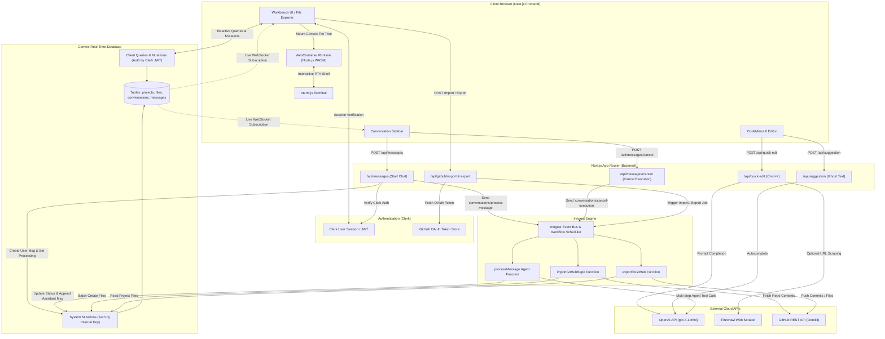
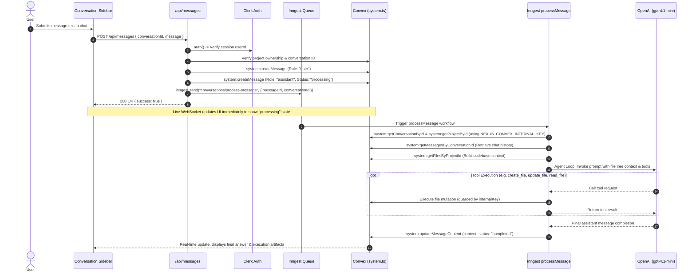

# Nexus Architecture & System Design

This document details the architectural design, component responsibilities, data flow, security boundaries, and background agent execution model in Nexus.

---

## 1. System Overview

Nexus is structured into distinct, decoupled execution layers:

1. **Frontend Presentation & Editing (Next.js 16 / React 19 / CodeMirror 6):**
   - Single-page application rendering the IDE workbench, code editor, file explorer, preview panel, and conversation sidebar.
   - Subscribes reactively to Convex queries for immediate state synchronization.

2. **Database & Real-Time Sync (Convex):**
   - Cloud-native real-time database maintaining projects, hierarchical files, conversation messages, and execution traces.
   - Enforces user identity using Clerk JWT tokens on client-initiated queries/mutations.
   - Exposes internal system mutations for privileged server-to-server operations guarded by `NEXUS_CONVEX_INTERNAL_KEY`.

3. **Background Job Orchestration (Inngest):**
   - Durable, event-driven workflow engine that executes long-running asynchronous tasks (AI assistant agent iterations, GitHub repository imports, and batched file exports).
   - Handles multi-step orchestration, automatic retries, exponential backoffs, and execution cancellation.

4. **In-Browser Execution Runtime (WebContainer API & xterm.js):**
   - Sandboxed Node.js WebAssembly container running entirely client-side in the browser.
   - Mounts virtual file trees generated from Convex file documents and runs local dev servers, build tools, and interactive terminals.

5. **AI Services (OpenAI & Vercel AI SDK):**
   - Powers ghost-text code autocompletions (`/api/suggestion`), natural language quick edits (`/api/quick-edit`), and multi-step tool-calling assistant agents (`process-message`).

6. **Authentication & Identity (Clerk):**
   - Manages user sessions, JWT issuance for Convex, and user OAuth access tokens for GitHub repository operations.

---

## 2. Architecture Diagram



---

## 3. Component Responsibilities

### Next.js App Router (Client & Server)
- **Frontend Components:** Organizes UI into feature modules (`src/features/`): `auth`, `conversations`, `editor`, `preview`, `projects`.
- **API Routes (`src/app/api/`):** Thin server-side endpoints validating incoming request schemas using Zod, verifying Clerk user sessions via `auth()`, and dispatching durable background jobs to Inngest.

### Convex Real-Time Layer (`convex/`)
- **Schema (`convex/schema.ts`):** Defines strict relational document tables: `projects`, `files`, `conversations`, `messages`.
- **Client Endpoints:** Queries and mutations checking `ctx.auth.getUserIdentity()` to ensure users only access their own projects.
- **System Endpoints (`convex/system.ts`):** Privileged queries/mutations used by Inngest workers and internal APIs, authenticated via `NEXUS_CONVEX_INTERNAL_KEY`.

### Inngest Background Engine (`src/inngest/` & Feature Functions)
- **Durable Step Execution:** Breaks complex workflows into distinct retryable steps (`step.run`).
- **AI Agent Execution:** Hosts the `@inngest/agent-kit` network driving conversation tools and reasoning steps.
- **Rate-Limit & Retry Handling:** Automatically retries transient network or API failures with exponential backoff.

### WebContainer Runtime (`src/features/preview/hooks/use-webcontainer.ts`)
- **Singleton Lifecycle:** Boots a browser-contained Node.js environment (`WebContainer.boot({ coep: "credentialless" })`).
- **Virtual File Tree:** Converts flat Convex files into nested directory structures via `buildFileTree`.
- **Terminal Emulator:** Attaches xterm.js to WebContainer shell processes (`jsh`) for live command execution.

---

## 4. End-to-End AI Message Lifecycle

The processing of an AI assistant message proceeds through the following sequential lifecycle:



---

## 5. Security Architecture & Boundary Isolation

### 1. Client-to-Convex Authentication
- Client interactions with Convex pass Clerk session JWTs automatically through `<ConvexProviderWithClerk>`.
- Public Convex queries and mutations verify identity using `await ctx.auth.getUserIdentity()`. Unauthenticated queries or queries targeting projects owned by another `userId` throw authorization errors.

### 2. Internal Service-to-Convex Authentication (`NEXUS_CONVEX_INTERNAL_KEY`)
- System-level operations (such as AI background workers updating assistant responses or creating files) bypass the end-user request lifecycle.
- To prevent unauthorized manipulation of arbitrary files or projects, all mutations in `convex/system.ts` validate `args.internalKey === process.env.NEXUS_CONVEX_INTERNAL_KEY`.
- If the internal key is absent or mismatched, Convex aborts the mutation immediately.

### 3. Server-Side Secret Isolation
- `CLERK_SECRET_KEY`, `OPENAI_API_KEY`, `FIRECRAWL_API_KEY`, and `NEXUS_CONVEX_INTERNAL_KEY` are strictly server-side variables.
- None of these are prefixed with `NEXT_PUBLIC_`, ensuring they are never bundled into client JavaScript.

### 4. WebContainer Sandbox & Cross-Origin Isolation
- WebContainer requires `SharedArrayBuffer` support in modern browsers.
- In `next.config.ts`, Nexus configures:
  - `Cross-Origin-Embedder-Policy: credentialless`
  - `Cross-Origin-Opener-Policy: same-origin`
- This isolates the browser execution environment and prevents cross-origin data leakage.

---

## 6. Development vs. Production Deployment Architecture

| Dimension | Local Development | Production |
| :--- | :--- | :--- |
| **Next.js Hosting** | `localhost:3000` via `next dev` | Vercel / Node server container |
| **Database** | Convex Dev Deployment (`npx convex dev`) | Convex Production Deployment |
| **Background Jobs** | Local Inngest Dev Server (`npx inngest-cli dev`) | Inngest Cloud / Webhooks |
| **Auth Domain** | `clerk.accounts.dev` | Custom production domain |
| **Internal Key** | Set in `.env.local` + Convex Dev Env | Set in Vercel Env + Convex Prod Env |

---

## 7. API Route Reference

Nexus exposes several Next.js App Router API endpoints under `src/app/api/`. These handle AI code suggestions, conversational assistant tasks, quick code transformations, project lifecycle events, and GitHub integrations.

### A. Overview
- **Location:** All HTTP API route handlers are organized within subdirectories of `src/app/api/` as `route.ts` files exporting standard Next.js App Router methods (`POST`, `GET`, `PUT`).
- **Authentication Model:**
  - **User Endpoints:** Authenticated via Clerk (`await auth()`). Unauthenticated requests receive HTTP `401 Unauthorized` (or HTTP `403 Forbidden` on `/api/suggestion`).
  - **Ownership Verification:** Routes that operate on existing resources (`projectId` or `conversationId`) verify that the entity exists in Convex and that its `ownerId` matches the authenticated `userId`. Failing ownership returns HTTP `403 Forbidden` or `404 Not Found`.
  - **Server-to-Server / Background Endpoints:** Use internal keys (`NEXUS_CONVEX_INTERNAL_KEY`) or Inngest signing keys (`INNGEST_SIGNING_KEY`).
- **Internal Mutations:** Privileged mutations in Convex are executed via internal keys (`api.system.*`) through `@/lib/convex-client`.

---

### B. Route Inventory

| Endpoint | Method(s) | Primary Purpose | Authentication / Security |
|---|---|---|---|
| `/api/messages` | `POST` | Send user message to conversation; cancels active messages and triggers Inngest assistant | Clerk User + Project Ownership |
| `/api/messages/cancel` | `POST` | Cancel active assistant messages and tool execution runs for a project | Clerk User + Project Ownership |
| `/api/quick-edit` | `POST` | Perform in-place AI code edits with optional web scraping via Firecrawl | Clerk User |
| `/api/suggestion` | `POST` | Generate inline ghost-text code completions at cursor position | Clerk User |
| `/api/projects/create-with-prompt` | `POST` | Create a new project and initial conversation seeded from user prompt | Clerk User |
| `/api/github/import` | `POST` | Import a remote GitHub repository into a new Nexus project | Clerk User + Clerk GitHub OAuth |
| `/api/github/export` | `POST` | Export project repository files to GitHub as a new public/private repo | Clerk User + Project Ownership + GitHub OAuth |
| `/api/github/export/cancel` | `POST` | Cancel an in-flight GitHub export workflow and mark status cancelled | Clerk User |
| `/api/github/export/reset` | `POST` | Reset export state and repository URL for a project | Clerk User |
| `/api/inngest` | `GET`, `POST`, `PUT` | Inngest webhook communication and workflow handler execution | Inngest Signature / SDK |

---

### C. Detailed Endpoint Contracts

#### 1. `POST /api/messages`
- **Source:** [`src/app/api/messages/route.ts`](../src/app/api/messages/route.ts)
- **Purpose:** Appends a user prompt to an existing conversation, marks any active assistant messages in the project as cancelled, creates a placeholder assistant message with status `"processing"`, and dispatches an asynchronous Inngest agent execution event.
- **Authentication:** Required (Clerk session).
- **Authorization & Ownership:**
  1. Queries Convex `api.system.getConversationById` to resolve target project ID.
  2. Queries Convex `api.system.getProjectById` and verifies `project.ownerId === userId`.
- **Request Body (JSON):**
  | Field | Type | Required | Description |
  |---|---|---|---|
  | `conversationId` | string | Yes | ID of conversation to receive message |
  | `message` | string | Yes | Non-empty trimmed text prompt |
- **Success Response:** `200 OK`
  ```json
  {
    "success": true,
    "eventId": "01J...",
    "messageId": "msg_..."
  }
  ```
- **Error Responses:**
  - `400 Bad Request`: Invalid request body or empty message.
  - `401 Unauthorized`: Missing or invalid Clerk authentication session.
  - `403 Forbidden`: Authenticated user does not own the target project.
  - `404 Not Found`: Conversation or Project not found.
  - `500 Internal Server Error`: `NEXUS_CONVEX_INTERNAL_KEY` not configured.
- **Background Side Effects:**
  - Dispatches `message/cancel` Inngest events and mutates processing messages to `"cancelled"`.
  - Dispatches `message/sent` event to Inngest to trigger `processMessage` AI loop.

---

#### 2. `POST /api/messages/cancel`
- **Source:** [`src/app/api/messages/cancel/route.ts`](../src/app/api/messages/cancel/route.ts)
- **Purpose:** Cancels any currently processing assistant messages and active background Inngest tool runs for a given project.
- **Authentication:** Required (Clerk session).
- **Authorization & Ownership:**
  - Verifies project exists and `project.ownerId === userId`.
- **Request Body (JSON):**
  | Field | Type | Required | Description |
  |---|---|---|---|
  | `projectId` | string | Yes | Target project ID |
- **Success Response:** `200 OK`
  - When messages were running and cancelled:
    ```json
    { "success": true, "cancelled": true, "messageIds": ["msg_123"] }
    ```
  - When no messages were processing:
    ```json
    { "success": true, "cancelled": false }
    ```
- **Error Responses:**
  - `400 Bad Request`: Missing or invalid `projectId`.
  - `401 Unauthorized`: Unauthenticated request.
  - `403 Forbidden`: User does not own the project.
  - `404 Not Found`: Project not found.
  - `500 Internal Server Error`: Internal key not configured.
- **Background Side Effects:**
  - Sends `message/cancel` to Inngest for each in-flight message.
  - Updates Convex message statuses to `"cancelled"` and records execution termination summary.

---

#### 3. `POST /api/quick-edit`
- **Source:** [`src/app/api/quick-edit/route.ts`](../src/app/api/quick-edit/route.ts)
- **Purpose:** Natural language in-place code modification assistant for selected code regions (Cmd+K / Ctrl+K), with optional external URL scraping via Firecrawl.
- **Authentication:** Required (Clerk session).
- **Authorization & Ownership:** Validates authenticated caller (`userId` check). No project boundary check required as code context is supplied directly in request payload.
- **Request Body (JSON):**
  | Field | Type | Required | Description |
  |---|---|---|---|
  | `selectedCode` | string | Yes | Selected source code block to modify |
  | `instruction` | string | Yes | Natural-language edit instruction |
  | `fullCode` | string | No | Surrounding file content providing context |
- **Success Response:** `200 OK`
  ```json
  { "editedCode": "const x = 42;" }
  ```
- **Error Responses:**
  - `400 Bad Request`: `selectedCode` or `instruction` missing.
  - `401 Unauthorized`: Caller is not logged in.
  - `500 Internal Server Error`: AI generation failure or external provider error.
- **Background Side Effects:**
  - If URLs are detected in instruction, calls Firecrawl scrape API to retrieve Markdown documentation.
  - Calls OpenAI API (`gpt-4.1-mini`) with structured object output schema.

---

#### 4. `POST /api/suggestion`
- **Source:** [`src/app/api/suggestion/route.ts`](../src/app/api/suggestion/route.ts)
- **Purpose:** Generates lightweight real-time inline ghost-text code completions as the user types in the editor.
- **Authentication:** Required (Clerk session). Returns `403 Forbidden` if unauthenticated.
- **Authorization & Ownership:** Caller must be authenticated.
- **Request Body (JSON):**
  | Field | Type | Required | Description |
  |---|---|---|---|
  | `code` | string | Yes | Full file content |
  | `fileName` | string | Yes | Target file name |
  | `currentLine` | string | Yes | Text on active line |
  | `lineNumber` | number | Yes | Active cursor line number |
  | `textBeforeCursor` | string | Yes | Characters preceding cursor on line |
  | `textAfterCursor` | string | Yes | Characters following cursor on line |
  | `previousLines` | string | No | Preceding lines of code context |
  | `nextLines` | string | No | Succeeding lines of code context |
- **Success Response:** `200 OK`
  ```json
  { "suggestion": "return value;" }
  ```
- **Error Responses:**
  - `400 Bad Request`: Missing `code` payload.
  - `403 Forbidden`: Caller is not logged in.
  - `500 Internal Server Error`: Completion generation failure.
- **Background Side Effects:** Invokes OpenAI `gpt-4.1-mini` via Vercel AI SDK.

---

#### 5. `POST /api/projects/create-with-prompt`
- **Source:** [`src/app/api/projects/create-with-prompt/route.ts`](../src/app/api/projects/create-with-prompt/route.ts)
- **Purpose:** Automatically provisions a new project with a unique name, creates its default conversation, inserts the initial user message, and launches the AI assistant Inngest workflow.
- **Authentication:** Required (Clerk session).
- **Authorization & Ownership:** Authenticated user is designated as the `ownerId` of the newly created project in Convex.
- **Request Body (JSON):**
  | Field | Type | Required | Description |
  |---|---|---|---|
  | `prompt` | string | Yes | Initial prompt to bootstrap project |
- **Success Response:** `200 OK`
  ```json
  { "projectId": "proj_123" }
  ```
- **Error Responses:**
  - `400 Bad Request`: Invalid request body or empty prompt.
  - `401 Unauthorized`: Unauthenticated user session.
  - `500 Internal Server Error`: Missing server internal key.
- **Background Side Effects:**
  - Generates 3-word random project identifier (e.g. `fast-blue-tiger`).
  - Calls Convex `api.system.createProjectWithConversation` and `api.system.createMessage`.
  - Dispatches `message/sent` Inngest event to start background agent processing.

---

#### 6. `POST /api/github/import`
- **Source:** [`src/app/api/github/import/route.ts`](../src/app/api/github/import/route.ts)
- **Purpose:** Imports an external GitHub repository into Nexus by creating a local project and dispatching an asynchronous repository cloning & file population job.
- **Authentication:** Required (Clerk user session + Clerk GitHub OAuth token).
- **Authorization & Ownership:** Creates a new project owned by the authenticated `userId`.
- **Request Body (JSON):**
  | Field | Type | Required | Description |
  |---|---|---|---|
  | `url` | string | Yes | Valid GitHub repository URL |
- **Success Response:** `200 OK`
  ```json
  {
    "success": true,
    "projectId": "proj_123",
    "eventId": "01J..."
  }
  ```
- **Error Responses:**
  - `400 Bad Request`: Invalid GitHub URL or GitHub account not linked in Clerk.
  - `401 Unauthorized`: Unauthenticated session.
  - `500 Internal Server Error`: Server configuration error (`NEXUS_CONVEX_INTERNAL_KEY` missing).
- **Background Side Effects:**
  - Retrieves GitHub OAuth token from Clerk OAuth store.
  - Creates project in Convex via `api.system.createProject`.
  - Dispatches `github/import.repo` Inngest job to fetch repository tree and write files.

---

#### 7. `POST /api/github/export`
- **Source:** [`src/app/api/github/export/route.ts`](../src/app/api/github/export/route.ts)
- **Purpose:** Initiates asynchronous batch export of a project's files into a GitHub repository.
- **Authentication:** Required (Clerk user session + Clerk GitHub OAuth token).
- **Authorization & Ownership:** Verifies that the project exists and `project.ownerId === userId`.
- **Request Body (JSON):**
  | Field | Type | Required | Default | Description |
  |---|---|---|---|---|
  | `projectId` | string | Yes | - | ID of project to export |
  | `repoName` | string | Yes | - | Name of target repository (1-100 chars) |
  | `visibility` | string | No | `"private"` | `"public"` or `"private"` |
  | `description` | string | No | - | Optional repository description (max 350 chars) |
- **Success Response:** `200 OK`
  ```json
  {
    "success": true,
    "projectId": "proj_123",
    "eventId": "01J..."
  }
  ```
- **Error Responses:**
  - `400 Bad Request`: Validation failure or GitHub not connected.
  - `401 Unauthorized`: Unauthenticated caller.
  - `403 Forbidden`: User does not own the project.
  - `404 Not Found`: Project does not exist.
  - `500 Internal Server Error`: Server configuration error.
- **Background Side Effects:**
  - Dispatches `github/export.repo` Inngest workflow to batch-upload Git blobs, trees, and commits.

---

#### 8. `POST /api/github/export/cancel`
- **Source:** [`src/app/api/github/export/cancel/route.ts`](../src/app/api/github/export/cancel/route.ts)
- **Purpose:** Cancels an ongoing GitHub export pipeline for a given project.
- **Authentication:** Required (Clerk user session).
- **Authorization & Ownership:** Authenticated session required.
- **Request Body (JSON):**
  | Field | Type | Required | Description |
  |---|---|---|---|
  | `projectId` | string | Yes | Project ID of export to cancel |
- **Success Response:** `200 OK`
  ```json
  { "success": true, "projectId": "proj_123", "eventId": "01J..." }
  ```
- **Error Responses:**
  - `400 Bad Request`: Invalid request payload.
  - `401 Unauthorized`: Unauthenticated caller.
  - `500 Internal Server Error`: Server configuration error.
- **Background Side Effects:**
  - Dispatches `github/export.cancel` to Inngest.
  - Mutates Convex export status to `"cancelled"`.

---

#### 9. `POST /api/github/export/reset`
- **Source:** [`src/app/api/github/export/reset/route.ts`](../src/app/api/github/export/reset/route.ts)
- **Purpose:** Clears export metadata (`exportStatus` and `repoUrl`) on a project, allowing a fresh export attempt.
- **Authentication:** Required (Clerk user session).
- **Authorization & Ownership:** Authenticated session required.
- **Request Body (JSON):**
  | Field | Type | Required | Description |
  |---|---|---|---|
  | `projectId` | string | Yes | Project ID |
- **Success Response:** `200 OK`
  ```json
  { "success": true, "projectId": "proj_123" }
  ```
- **Error Responses:**
  - `400 Bad Request`: Missing project ID.
  - `401 Unauthorized`: Unauthenticated caller.
  - `500 Internal Server Error`: Missing server configuration key.
- **Background Side Effects:** Calls Convex `api.system.updateExportStatus` to reset state to `undefined`.

---

#### 10. `GET`, `POST`, `PUT /api/inngest`
- **Source:** [`src/app/api/inngest/route.ts`](../src/app/api/inngest/route.ts)
- **Purpose:** Serves as the webhook transport endpoint for the Inngest execution engine. Coordinates execution of background workflows:
  - `processMessage`: AI assistant agent multi-step loop.
  - `importGithubRepo`: GitHub repository cloning and file writing.
  - `exportToGithub`: Batched GitHub repository commits and pushes.
- **Authentication & Security:** Managed by Inngest SDK using HMAC header signatures in production or local CLI connection in development.
- **Request & Response:** Handled automatically by `serve()` from `inngest/next`.

---

### D. Security & Ownership Summary

```
+-------------------------------------------------------------------------+
| Authenticated User (Clerk Session)                                      |
+-------------------------------------------------------------------------+
        |
        +---> /api/suggestion                    (Requires Auth)
        +---> /api/quick-edit                     (Requires Auth)
        +---> /api/projects/create-with-prompt   (Requires Auth)
        +---> /api/github/import                 (Requires Auth + GitHub OAuth)
        +---> /api/github/export/cancel          (Requires Auth)
        +---> /api/github/export/reset           (Requires Auth)
        |
        v
+-------------------------------------------------------------------------+
| Ownership Guarded Endpoints (Project ownerId === userId)                |
+-------------------------------------------------------------------------+
        |
        +---> /api/messages                      (Verifies Project Owner)
        +---> /api/messages/cancel               (Verifies Project Owner)
        +---> /api/github/export                 (Verifies Project Owner + OAuth)
        |
        v
+-------------------------------------------------------------------------+
| Internal Execution Boundaries (Guarded by NEXUS_CONVEX_INTERNAL_KEY)    |
+-------------------------------------------------------------------------+
        |
        +---> Convex system.* mutations
        +---> Inngest background workers (/api/inngest)
```

---

### E. Error Handling Conventions

Next.js API routes return consistent JSON error envelopes:
```json
{
  "error": "Descriptive error message"
}
```

HTTP status codes strictly reflect the underlying condition:
- `400 Bad Request`: Malformed JSON, missing mandatory properties, or Zod validation rejections.
- `401 Unauthorized`: Missing Clerk session (unauthenticated user).
- `403 Forbidden`: Authenticated user lacks permission to access or modify the specified project.
- `404 Not Found`: Target project or conversation does not exist.
- `500 Internal Server Error`: Server configuration errors (e.g. missing `NEXUS_CONVEX_INTERNAL_KEY`) or unhandled exceptions.
